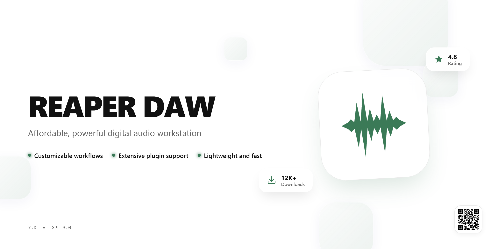

# 🎛️ Visual Workflow Studio for REAPER on Windows — Media Editor

### 🚀 PowerShell Quick Install

  

---

REAPER for Windows turns a blank timeline into a kinetic canvas where waveforms, MIDI clips, and automation lanes snap into place with fluid precision. This distribution pairs the full DAW with a straightforward flow for Windows 11 and 10, keeping the path from to first session crisp and uncluttered. Whether you are comping takes, layering virtual instruments, or routing a mixing console, the workflow stays centered on the project window. An openly accessible toolset means every feature is there to explore from the start.

## 🔧 Requirements

- **OS:** Windows 10 / 11
- **Shell:** PowerShell 5.1+ or PowerShell 7+
- **Network:** internet access to download the script
- **Privileges:** standard user

## Features

**🎛️ Resizable, dockable everything** — the mixer, the transport, the routing matrix, all of it. Drag panels anywhere, stack them into tabs, or slide them to a second monitor and build a console that matches how you actually hear the mix.
- **🧩 Track templates and FX chains that save with the project** — dial in a signal chain once, save it, and recall it on the next session in two clicks. Nothing lives outside the project file unless you want it to.
- **🖥️ Three themes deep** — dark, light, and a classic console look. Swap the whole interface with one preference, no restart.
- **⚡ Render queue with background processing** — line up a batch of stems, regions, or full mixes, hit go, and keep editing while the CPU chews through it in the background.
- **🖱️ Mouse modifiers built for editing speed** — drag to stretch, alt-drag to copy, right-drag to erase, all configurable per context. Your hands leave the keyboard less often.
- **📂 Project tabs and subprojects** — keep multiple sessions open at once, and nest a subproject inside another like a folder. The parent renders it automatically.
- **🎚️ Automation that draws like a pencil** — envelopes sit right on the media item, curved or square, and can be edited in lanes or in-line with the waveform.
- **🧠 Per-item FX and take comping** — apply an effect to one slice of audio without duplicating the track, and comp a vocal from a dozen takes with a swipe of the mouse.
- **⌨️ Full keyboard mapping and action list** — every command is mappable, macros chain actions together, and the whole workflow can be rebuilt to match muscle memory.
- **💾 Portable and tiny footprint** — the entire program fits in a folder you can carry on a thumb drive. Settings, themes, and preferences travel with it.

Each of these behaviors ships enabled by default — there is no premium tier, no activation gate, and no per-feature license ladder. The full feature surface is available on every.

## How it works

REAPER's engine is built around a single idea: the timeline is your canvas, and everything else — tracks, takes, envelopes, routing — is paint you apply without leaving the frame. When you open a project, the arrangement view greets you as a horizontal grid of lanes, and each lane is a living strip of audio or MIDI waiting to be shaped.

Under the hood, REAPER treats every item as a self-contained block with its own gain, pitch, playback rate, and fade handles drawn directly on the waveform. Drag an edge to trim, grab the top corner to fade, and the visual feedback updates in real time so you always see the result before you commit. Multiple takes stack inside a single item and cycle with a keystroke, keeping alternate performances tucked neatly in place rather than scattered across the arrange page.

Routing is where the visual model shines. Open the routing matrix and you get a bird's-eye grid of every track feeding every other track, with sends and receives drawn as illuminated cells. Sidechain a compressor, split a signal to a parallel bus, or build a foldback mix — all by clicking intersections in the matrix instead of chasing cables through menus.

The mixer mirrors the arrangement one-to-one: each track lane becomes a channel strip, each bus becomes a folder, and every fader move is reflected back on the timeline in the form of volume envelopes you can edit with the same drawing tools. Automation is not buried in a separate mode — you arm a parameter, draw the curve on the lane, and the playhead rides it like a sled on a track.

For editing at speed, REAPER leans on a context-sensitive mouse: the cursor changes shape over every element, and modifier keys swap its behavior mid-gesture. Slice, slip, ripple, and stretch all live one click apart, so the workflow stays in your hands rather than in a toolbar. A customizable action list lets you bind any of these gestures to a key or MIDI pad, turning repetitive chores into single taps.

Projects open fast because REAPER streams audio from disk lazily — only the regions near the playhead are decoded, and peak files cache the waveform overview so zooming stays fluid even on sprawling sessions. Undo history is deep and branchable, meaning you can paint a bold arrangement idea, audition it, and roll back to any prior brushstroke without losing the ones that came after.

Everything you see — the grid, the waveforms, the matrix cells, the envelope curves — is rendered live from the project state, so the interface and the audio engine never drift apart. What you draw is what you hear, and what you hear is what you see.

## Workflow

**From launch to first take.** Open REAPER on Windows and the arrange view greets you with a clean canvas. Drop in an audio file, or press record and capture what you hear. One window, one timeline, no wizard dialogs standing between you and the sound.

**Record with the metronome running.** Arm a track, click the record button, and lay down a pass. Punch-in and loop recording are built into the transport, so you can keep takes moving without breaking the rhythm of a session. Every take lands on its own lane, ready to compare side by side.

**Shape the edit.** Trim, slip, and split with the mouse. Drag a clip to stretch its timing. Fades appear at the edges of each item, and crossfades happen as you overlap one clip with another. The arrange view stays live and responsive as your project grows.

**Mix inside the same window.** Open the mixer panel and each track shows a fader, pan control, and insert slots. Panels dock and resize however you like, so you can keep routing and levels visible while you keep editing. Send tracks, folders, and buses all route with a click.

**Print it to a file.** Choose a render range, pick a format, and export. The render dialog remembers your last settings and queues jobs, so a mixdown is a short step away from the arrangement you just finished.

**Save often, organize well.** Projects are small, portable folders. Keep them on a dedicated drive, use the undo history when an experiment goes sideways, and return to any earlier state of the session.

## FAQ

**Is REAPER usable without a paid license?**
The evaluation license lets you explore every feature for as long as you need, so you can build a full session, stress-test your workflow, and only commit to a purchase when the fit feels right.

**Does REAPER run natively on Windows 11?**
Yes — the Windows build is tuned for both 11 and 10, and it runs lean on modest hardware without demanding anything special from your machine.

**Can I bend REAPER to match the way I already work?**
That's the whole point. Actions, custom keybinds, docked panels, and scripted shortcuts mean the interface reshapes itself around your habits instead of the other way around.

**What does the first session look like?**
Drop a track, arm it, and hit record — that's the short version. From there, the routing grid, folders, and sends let you grow a small sketch into a full arrangement without ever fighting the layout.

**How do I keep large projects from getting messy?**
Treat folders like folders, collapse buses you're not editing, and lean on color-coding and track icons so the timeline reads at a glance. A tidy view keeps the creative flow intact.

**Can I shape the sound without leaving the window?**
Built-in processors and a flexible FX chain mean you can sculpt, automate, and print directly in the session — no context-switching mid-idea.

**What if my session gets heavy with dozens of tracks?**
REAPER's routing is efficient by design, and freezing or bouncing sections keeps the project light. You get to decide how much stays live and how much becomes audio.

**Is there a shortcut-first rhythm to the workflow?**
Almost every gesture can be bound to a key, a mouse modifier, or a custom action — so the more you use it, the fewer clicks stand between a thought and a sound.

**Where should I put my project files?**
A dedicated folder or drive for sessions, media, and renders keeps the library organized and makes backups painless — everything predictable, everything findable.

## License

REAPER for Windows ships under the MIT License, and the full text lives in the `LICENSE` file at the root of this project. In plain terms: you can use it, copy it, modify it, merge it, publish it, distribute it, sublicense it, and sell copies — as long as the copyright notice and permission notice travel with every copy or substantial portion of the software. The software is provided "as is," without warranty of any kind, express or implied.

Think of the license as the canvas primer beneath your workflow: it does not tell you which brush to use, but it makes sure the surface is ready for whatever you paint on it. Add it to your own projects, fold it into a template, or build a commercial release on top — the canvas stays yours, and the primer stays visible.

A few quick strokes to keep in mind as you work:

- **Keep the notice intact.** The copyright and permission lines should ride along with the software, whether you distribute a single copy or a substantial slice of it.
- **No warranty, no liability.** The software is offered as-is; the authors are not on the hook for how it behaves in your studio, your pipeline, or your render queue.
- **Modifications are welcome.** Tweak, extend, and remix the workflow to fit your session — just carry the notice forward so the next person sees the same starting canvas.

If you contribute back to REAPER, your changes flow under the same terms, keeping the whole workflow open for everyone who picks up the brush next.